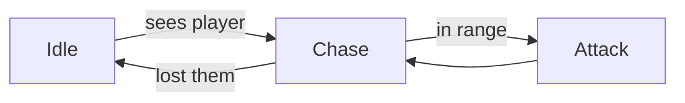

# Elements

Every element a wiki page can use, with its syntax. The toolbox (`/toolbox/<wiki>/elements`) renders this file, so each example below
shows how it looks in the default theme.

## Text

Paragraphs with **bold**, *italic*, ~~struck~~, `inline code` and [an external link](https://example.com).
Keys like :kbd[Ctrl] + :kbd[P], and badges: :badge[Neutral] :badge[Accent]{tone="accent"} :badge[Good]{tone="good"}
:badge[Warn]{tone="warn"} :badge[Bad]{tone="bad"}.

```md
:kbd[E] :badge[Rare]{tone="accent"}
```

> A blockquote, for quotes from people or sources.

- A list item
- Another one
  - Nested

1. First
2. Second

- [x] A finished task
- [ ] An open task

---

## Links

Wikilinks find a page by its path, its file name or its title, so `[[Goals]]` works from any page:

```md
[[Goals]]                       the page's title as the link text
[[plan/roadmap|the roadmap]]    your own text
[[Roadmap#Milestones|dates]]    a section of a page
| [[goals\|Goals]] |            in a table, escape the bar
```

A link to a page that doesn't exist yet is a red link, like [[A page nobody wrote]]: it marks a page worth writing,
and Special:Wanted pages lists them all. Pointing at a link to a page shows a preview of it, and the icon after a
heading copies a link to that section. Plain Markdown links (`[text](path)`) still work, and a broken one is reported.

## Code

Fence code with its language and it's colored in the wiki's theme, with the language and a copy button above it:

```luau
-- Heals the player, never past their maximum.
local function heal(player: Player, amount: number)
	local humanoid = player.Character and player.Character:FindFirstChild("Humanoid")
	if humanoid then
		humanoid.Health = math.min(humanoid.Health + amount, humanoid.MaxHealth)
	end
end
```

```ts
export const price = (cents: number) => `$${(cents / 100).toFixed(2)}`;
```

Colored languages: `ts`, `tsx`, `js`, `jsx`, `json`, `css`, `html`, `bash` (`sh`), `powershell`, `python`, `lua`,
`luau`, `gdscript`, `rust`, `csharp`, `yaml`, `toml`, `md`, `sql`, `diff`. Others show as plain text.

## Callouts

:::callout
A note, the default tone.
:::

:::callout[Tip]{tone="tip"}
Callouts take an optional title in brackets.
:::

:::callout{tone="warning"}
Something to be careful about.
:::

:::callout[Breaking]{tone="danger"}
Something that will go wrong.
:::

```md
:::callout[Title]{tone="note|tip|warning|danger"}
Text.
:::
```

## Infobox

:::infobox[Thief Rat]{caption="Steals one item, then runs."}
- Health: 20
- Speed: **Fast**
- Drops: Cheese, Rat tail
- Found in: Every island
:::

Infoboxes float to the side of the text that follows them on wide screens, like on game wikis. They take an optional
`image` from `assets/`, and each `- Key: value` line becomes a row.

```md
:::infobox[Thief Rat]{image="/assets/rat.png" caption="…"}
- Health: 20
- Speed: Fast
:::
```

## Tabs

::::tabs
:::tab[Melee]
Short range, high damage.
:::
:::tab[Ranged]
Long range, lower damage.
:::
:::tab[Suggestions]{tone="good"}
A tab with a `tone` (`accent`, `good`, `warn`, `bad`) stands out in that color, its panel tinted to match.
:::
::::

```md
::::tabs
:::tab[Melee]
…
:::
:::tab[Suggestions]{tone="good"}
…
:::
::::
```

## Columns

:::columns
**Left.** Columns stack on narrow screens.

---

**Right.** Separate them with a `---` line.
:::

## Details

:::details[Spoilers]
Hidden until opened.
:::

```md
:::details[Summary]
Hidden text.
:::
```

## Spoilers

The ending :spoiler[was a dream all along]. Readers click the blurred words to see them.

:::spoiler[How the story ends]
Hidden until opened, like details, and marked as a spoiler.
:::

```md
The ending :spoiler[was a dream all along].

:::spoiler[How the story ends]
Hidden until opened.
:::
```

## Private

:::private[Game code]
Damage comes from `MobConfig.Damage`; never in the public wiki.
:::

A block or :private[a few words] the public wiki (ADR-0011) leaves out. The app shows them, marked. The note in
the brackets says why, for the people working on the wiki.

```md
:::private[Game code]
What only the team sees.
:::

Spawns every :private[90 seconds, from SpawnService] few minutes.
```

## Questions

::question{id=q1}

Open decisions, answered on the page. List them in the frontmatter; people pick an option and/or write a note, and
the answers wait in the agent's inbox (`pnpm shiori inbox`). The agent decides and writes it back as
`status: resolved` with the `answer`. `::question{id=…}` places one in the text; the rest collect under "Questions"
at the bottom of the page, and Special:Questions lists them across the wiki. (Here on the reference page there's no
frontmatter, so it shows a placeholder.)

```md
---
questions:
  - id: q1
    text: "Which platform do we launch on first?"
    options: [Steam, itch.io, Both]
  - id: q2
    text: "Who designs the logo?"
    status: resolved
    answer: "Nari, by the end of the month"
---
::question{id=q1}
```

## Suggestions

::suggestion{id=s1}

The agent's ideas for a page, in green: what to add or improve, where questions ask about what's there. The agent
writes 3 to 6 after reviewing a page (within the wiki's `settings.json`), with the same fields as questions; people
answer them the same way, and they collect under "Suggestions", below the questions. Once decided, what an answer
asks for waits in the page's `## Incoming changes`, a private list of tasks, until it's built; the page's text
changes only then.

```md
---
suggestions:
  - id: s1
    text: "Add a weekly leaderboard so players come back?"
    options: [Yes, Later, No]
---
::suggestion{id=s1}
```

## Related pages

::related

Typed links to other pages, from the frontmatter. Names work like wikilinks; the kind is free text. `::related`
places the box (`::related{kind="Depends on"}` shows one kind); without it, the box shows at the bottom of the page.

```md
---
related:
  - Goals
  - to: Audience & market
    kind: Competitor of
---
::related
```

## Children and contents

::children

::toc

`::children` lists the pages under this one, as cards or `{layout=list}`; when a page places it, the cards at the
bottom aren't repeated. `::toc` puts the page's contents inside the article, numbered like Wikipedia's.

```md
::children{layout=list}
::toc
```

## Status and page chips

Shipping is :status[active], the shop is :status[paused], the logo is :status[done]. Mention a page as a chip:
:page[Goals], or one not written yet: :page[Launch checklist].

```md
:status[active]   one of idea, planned, active, paused, done, archived
:page[Goals]      any page, found like a wikilink
```

## Steps

:::steps[Upload a video]
1. Export: 1080p, H.264, stereo audio.
2. Thumbnail: big face, three words at most.
3. Write the description, with the links from the [Plan](/plan).
4. Schedule it for Thursday, 6 pm.
:::

A numbered how-to: a setup guide, a recipe, an upload checklist. `- Title: text` gives a step a title.

```md
:::steps[Upload a video]
1. Export: 1080p, H.264.
2. Write the description.
:::
```

## Compare

:::compare{pick="A marketplace"}
### Our own shop
- Pro: Full control over the look
- Pro: No marketplace fees
- Con: We bring every visitor ourselves
- Cost: $39 a month

### A marketplace
- Pro: Buyers are already there
- Con: 10% fee on each sale
- Cost: Free to start
:::

Options side by side, for a decision. Each option starts with a heading; `- Pro:` and `- Con:` lines are marked,
other `- Label:` lines are plain facts. `pick` marks the chosen one.

```md
:::compare{pick="A marketplace"}
### Our own shop
- Pro: Full control
- Con: We bring every visitor
### A marketplace
- Pro: Buyers are already there
:::
```

## Quote

:::quote{by="Sam" role="Streamer, 40k followers" source="Interview, May 2026"}
Setting things up takes me longer than the stream itself.
:::

A quote with who said it and where, for interviews and research. `url="https://…"` links the source.

```md
:::quote{by="Sam" role="Streamer" source="Interview" url="https://…"}
What they said.
:::
```

## Embed

::embed[Big Buck Bunny, the Blender open movie]{url="https://www.youtube.com/watch?v=aqz-KE-bpKQ"}

A video or design played in place: YouTube, Vimeo and Figma links only. Quote the URL. The `[label]` is the caption.

```md
::embed[Trailer]{url="https://www.youtube.com/watch?v=…"}
::embed{url="https://vimeo.com/…"}
::embed{url="https://www.figma.com/design/…"}
```

## Tables

| Weapon | Damage | Speed |
|---|---:|---|
| Sword | 12 | Medium |
| Dagger | 6 | Fast |
| Hammer | 20 | Slow |

## Data tables

Wrap a table in `:::table` and people can sort it (click a column: up, down, back) and filter it. With six rows or
more a filter box shows: words to find, or a column and a test, `damage>10`, `speed:fast`, `name!=sword`. `stats`
adds a foot with the average, lowest and highest of each number column (or name them: `stats="sum, avg"`), over the
rows shown.

:::table[Weapons]{sort="-Damage" stats}
| Weapon | Damage | Speed | Price |
|---|---|---|---|
| Sword | 12 | Medium | $40 |
| Dagger | 6 | Fast | $15 |
| Hammer | 20 | Slow | $55 |
| Spear | 14 | Medium | $35 |
| Bow | 9 | Fast | $45 |
| Staff | 4 | Slow | $1.2k |
:::

A table can also fill itself, from a data file in the wiki (CSV, TSV, or JSON as a list of objects) or from the
wiki's pages: one row per page, with the page's `infobox` rows and its own frontmatter keys (`hp: 20`) as columns.

```md
::table[Mobs]{src="/tables/mobs.csv" sort="-HP"}
::table[Every mob]{pages="type:Mob" columns="Page, HP, Damage, Biome" stats}
::table{pages="in:mobs, tag:boss"}
```

`pages` takes terms joined by commas, all of which must match: `type:Mob`, `tag:boss`, `status:active`, `in:mobs`
(a folder and below), or any field the pages have (`biome:forest`). `columns` picks and orders them (`Page` is the
linked page). The page holding the table isn't listed in it.

## Math

Formulas are typeset with KaTeX: `$$E = mc^2$$` inside a sentence gives $$E = mc^2$$, and `$$` on lines of their own
make a block. A single `$` is just a dollar sign, so $5 stays $5.

$$
\text{damage} = \max\left(1,\ \text{attack} \times \frac{100}{100 + \text{armor}}\right)
$$

A ```` ```math ```` fence works too. A formula KaTeX can't read shows in red and `pnpm shiori check` reports it.

## Diagrams

A ```` ```mermaid ```` fence is drawn as a diagram, in the wiki's colors: flowcharts, sequence, state, class and ER
diagrams, gantt charts, timelines, mind maps and pies. A wide one scrolls sideways.



## Code

```ts
export function hit(target: Mob, damage: number) {
  target.health -= damage;
}
```

## Stats

:::stats
- Subscribers: 12.4k | +8% this month
- Avg. view time: 4:12 | +0:20
- Revenue: $3,180 | -4%
- Videos: 42
:::

Numbers at a glance: channel stats, shop sales, playtest results. Each `- Label: value` line is a tile; an optional
`| change` after it shows the trend, green when it starts with `+`, red with `-`.

```md
:::stats
- Subscribers: 12.4k | +8% this month
- Videos: 42
:::
```

## Timeline

:::timeline
- [x] January: Idea and research
- [x] February: First prototype
- [ ] March: Playtest with friends
- [ ] May: **Public launch**
:::

A short roadmap. Ticked items are done, the first open one is marked *Now*, and the rest are next. Items without a
task box are plain entries (a history, a changelog).

```md
:::timeline
- [x] January: Idea and research
- [ ] March: Playtest with friends
:::
```

## Roadmap

::::roadmap
:::milestone[Prototype]{version="0.1" when="March" icon="puzzle" goal="five friends played it"}
The one core idea, rough but playable.

- [x] Movement and one enemy
- [ ] Five friends play it
:::

:::milestone[Demo]{version="0.5" when="May" icon="sparkles" goal="the demo is on the store page"}
- [ ] Three levels
- [ ] A trailer
:::

:::milestone[Full game]{version="1.0" status="later" icon="target"}
Everything else, once the demo says it's worth it.
:::
::::

A page's roadmap: milestones by version, release or goal, each with what it is and its tasks, and the current one
put forward. It's drawn as chapters down the page, release by release: the version on the left, finished ones folded,
the current one marked. A milestone takes a `[Name]` and any of `version`, `when`, `goal` (when it's done), `icon` and
`status` (`done`, `now`, `next`, `later`). Without a `status`, its tasks decide: all ticked is done, the first one
that isn't is now, the rest are next. Its tasks count in Tasks and To do like any others.

```md
::::roadmap
:::milestone[Prototype]{version="0.1" when="March" goal="five friends played it"}
The one core idea, rough but playable.

- [x] Movement and one enemy
- [ ] Five friends play it
:::

:::milestone[Full game]{version="1.0" status="later"}
:::
::::
```

## Cards

:::cards
- :icon[target] [Goals](https://example.com) — What we're aiming for, and how we'll know.
- :icon[map] [Roadmap](https://example.com) — Milestones and dates.
- :icon[magnifier] [Research](https://example.com) — Sources, notes and findings.
:::

A grid of links, for hub pages. Start an item with its icon (`:icon[name]` from Shiori's set, or an emoji), then
the link, then a short description.

```md
:::cards
- :icon[target] [Goals](plan/goals) — What we're aiming for.
:::
```

## Icons

Shiori draws its own icons, and every wiki can use them by name: :icon[compass] `compass`, :icon[target] `target`,
:icon[map] `map`, :icon[bulb] `bulb`, :icon[sword] `sword`, :icon[pin] `pin`. Toolbox → Icons shows them all. A
page names one in its frontmatter (`icon: compass`); `:icon[name]` puts one in a sentence, a table or a card. Use
the set first, so the same thing has the same icon everywhere; only when nothing fits, draw one for the wiki in
`assets/icons/` (`icon: "/assets/icons/carrot.svg"`) and reuse it.

```md
:icon[compass] The plan
```

## Gallery

:::gallery


:::

An inspiration board. Images go in `assets/`, one per line; click one to see it large. The caption is the image's
title (in quotes), or its alt text.

```md
:::gallery

:::
```

## Progress

:progress[Store launch checklist]{value="60"}

:progress[Episodes edited]{value="3" max="8"}

A bar for anything with a finish line. Out of 100 unless `max` is given (then it shows `3/8`). It works inline,
in tables too:

| Video | Script | Edit |
|---|---|---|
| Devlog #4 | :progress{value="100"} | :progress{value="40"} |
| Shorts pack | :progress{value="2" max="5"} | :progress{value="0"} |

```md
:progress[Launch]{value="60"}
:progress[Episodes]{value="3" max="8"}
```

## Designs

::designs{collection="sketches"}

A collection's designs: what people drew and described in the app, each with its drawing, name and status, and a
button that starts a new one. The collection comes from the wiki's `wiki.json`; a layout's `designs` block shows
the same.

```md
::designs{collection="sketches"}
```

## Sheet

::sheet{name="mobs"}

A data sheet (ADR-0010): the table `sheets/mobs.json` that an agent wrote, its editable values ready to tune. Every
value shows its default from the file, and the owner shares the sheet alone from its page (Tools → Data sheets).
Only agents make sheets, with `pnpm shiori sheet <wiki> new <name>`.

```md
::sheet{name="mobs"}
```

## Home page

A wiki's home page (`pages/index.md`) shows wide, as a portal. Build it from titled boxes in a grid, and fill them
with the project's own links and text and with blocks that show the whole wiki live. Each wiki picks its own, so
every front page is different.

::::boxes
:::box[Start here]{icon="compass"}
- :page[Plan] — goals and the roadmap
- :page[Ideas] — everything worth trying
:::

:::box[Recent changes]{icon="clock"}
::recent-changes{count="4"}
:::

:::box[Open questions]{icon="question"}
::open-questions{count="3"}
:::

:::box[Latest discussions]{icon="people" span="2"}
::discussions{count="3"}
:::

:::box[To do]{icon="checklist"}
::open-tasks{count="4"}
:::

:::box[Everything in this wiki]{icon="books" span="3"}
::directory
:::
::::

`::::boxes` takes `columns` (2, 3 or 4; 3 by default) and holds only `:::box`es. A box has a title, an `icon` (a
name from Shiori's set, a picture of the wiki's own such as `/assets/icons/carrot.svg`, or an emoji) and can `span`
2 or 3 columns. The blocks take a `count` (1 to
50) and link to the special page with the whole list.

```md
::::boxes
:::box[Start here]{icon="compass"}
- :page[Plan] — goals and the roadmap
:::
:::box[Recent changes]{icon="clock"}
::recent-changes{count="6"}
:::
:::box[Open questions]
::open-questions{count="5"}
:::
:::box[Latest discussions]{span="2"}
::discussions{count="5"}
:::
:::box[To do]
::open-tasks{count="6"}
:::
:::box[Everything in this wiki]{span="3"}
::directory
:::
::::
```

## Changelog

A page's History, as on a game wiki: each version with what changed in it, oldest last. Give it a title for each
platform or edition when they differ.

:::changelog[PC]
- 0.3: Light radius raised from 10 to 12.
- 0.2:
  - Ember moths put out a lantern when five or more swarm it.
  - Costs 15 coins, down from 20.
- 0.1: Added.
:::

```md
## History

:::changelog[PC]
- 0.3: Light radius raised from 10 to 12.
- 0.2:
  - Ember moths put out a lantern when five or more swarm it.
  - Costs 15 coins, down from 20.
:::
```

## Navbox

A box of related pages in labelled rows, at the very end of an article, below its References. It folds, and the
page it sits on is marked in it. Write the rows as a list: `Label: link · link`, a label over a nested list of rows,
or links alone. Separate links with ` · `.

:::navbox[The world]
- Creatures: [[Moss fox]] · [[Ember moth]]
- Items
  - Tools: [[Glow lantern]]
  - Materials: [[Lantern oil]] · [[Fox fur]]
- Places: [[Old Grove]] · [[Willow River]]
:::

```md
:::navbox[The world]
- Creatures: [[Moss fox]] · [[Ember moth]]
- Items
  - Tools: [[Glow lantern]]
  - Materials: [[Lantern oil]] · [[Fox fur]]
:::
```

Or build it from a section of the page tree, so it never needs updating: a row for each folder, with its pages.
`[Title]` changes its title, which is the section's otherwise.

```md
::navbox{from="world"}
```

## Footnotes and references

Cite where a fact comes from with a footnote: `[^radius]` in the text, and `[^radius]: Where it's from.` on a line of
its own anywhere in the page. Citations are numbered in the order they appear, show what they cite on hover, and
jump to the page's references, which link back.[^radius] The list goes at the end of the article: under its last
heading when nothing is written under it (end the page with an empty `## References`, or the same in the wiki's
language), else under a "References" heading of its own. Navboxes stay after it.

A page that's read by players ends like a game wiki's article, in this order: `## Notes` (what to know that the
sections above don't say), `## Tips`, `## See also` when there's more to read, `## History` with a `:::changelog`,
`## References`, then the navboxes.

[^radius]: Measured in the 0.3 build: the light's range in studs, as players see it.

```md
The light reaches 12 studs.[^radius]

## References

[^radius]: Measured in the 0.3 build.

::navbox{from="world"}
```
