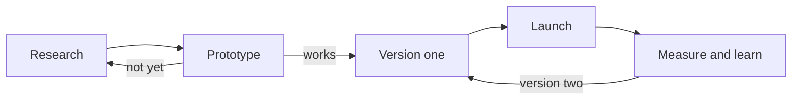

The roadmap is a promise to ourselves, not a contract: when reality disagrees, change the roadmap and log why in the
[Decision log](/notes/decisions).

## Milestones

:::timeline
- [x] Week 1: Research the space and write the pitch
- [ ] Weeks 2–3: Prototype the one core idea
- [ ] Weeks 4–6: Build version one
- [ ] Week 7: Launch to the first users (see the [[Launch checklist]])
- [ ] After launch: Measure, learn, and plan version two
:::

## How the work flows

Each milestone feeds the next; a prototype that doesn't work yet goes back to research, not forward.

## What each milestone needs

::::tabs
:::tab[Prototype]
The smallest thing that shows whether the core idea is fun, useful or interesting.

- [ ] The one core feature, rough but working
- [ ] Five people try it
- [ ] Notes on what they did, not just what they said
:::
:::tab[Version one]
Everything a stranger needs to use it without us in the room.

- [ ] The core feature, polished
- [ ] A first-run experience: store page, intro video, or tutorial
- [ ] A way to collect feedback
:::
:::tab[Launch]
Getting it in front of people.

- [ ] Launch post, trailer or announcement
- [ ] Share where the [[audience]] already is
- [ ] Watch the numbers on the first day, week and month
:::
::::

:::callout[Keep milestones small]{tone="tip"}
A milestone should end with something you can show. If one runs longer than three weeks, split it.
:::
