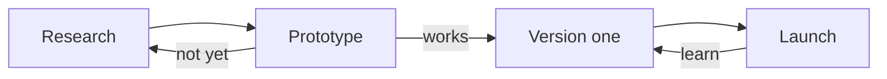

::::roadmap
:::milestone[Research]{version="0.1" when="Week 1" icon="magnifier" goal="the pitch fits in three sentences"}
Learn the space before building anything: who it's for, what exists, and what's missing.

- [x] Look at five similar projects
- [x] Talk to three people from the [[audience]]
- [x] Write the pitch
:::

:::milestone[Prototype]{version="0.2" when="Weeks 2–3" icon="puzzle" goal="five people tried it, and we know if the core idea works"}
The smallest thing that shows whether the core idea is fun, useful or interesting.

- [x] The one core feature, rough but working
- [ ] Five people try it
- [ ] Notes on what they did, not just what they said
:::

:::milestone[Version one]{version="1.0" when="Weeks 4–6" icon="sparkles" goal="a stranger can use it without us in the room"}
Everything a stranger needs to use it on their own.

- [ ] The core feature, polished
- [ ] A first-run experience: store page, intro video, or tutorial
- [ ] A way to collect feedback
:::

:::milestone[Launch]{version="1.0" when="Week 7" icon="signpost" goal="it's in front of the first users"}
Getting it in front of people (see the [[Launch checklist]]).

- [ ] Launch post, trailer or announcement
- [ ] Share where the [[audience]] already is
- [ ] Watch the numbers on the first day, week and month
:::

:::milestone[Version two]{version="2.0" when="After launch" status="later" icon="target" goal="the next version is planned from what we measured"}
Measure, learn, and plan what comes next.

- [ ] Read every piece of feedback
- [ ] Pick the three biggest changes
:::
::::

::::boxes
:::box[How the work flows]{icon="branch" span="3"}
Each milestone feeds the next; a prototype that doesn't work yet goes back to research, not forward.

:::

:::box[How we use it]{icon="compass" span="3"}
The roadmap is a promise to ourselves, not a contract: when reality disagrees, change it and log why in the
[Decision log](/notes/decisions).

**Keep milestones small.** Each one ends with something we can show, and says when it's done. If one runs longer
than three weeks, split it.

Goals for the whole project live in :page[Goals].
:::
::::
